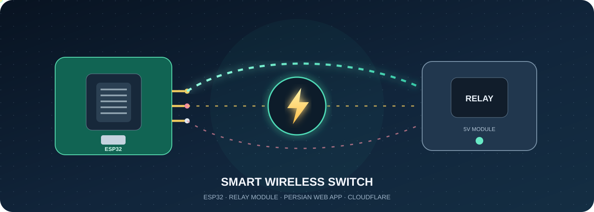
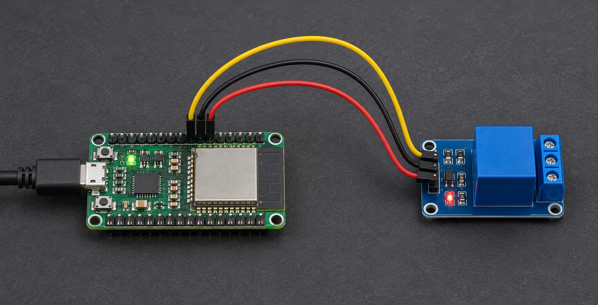
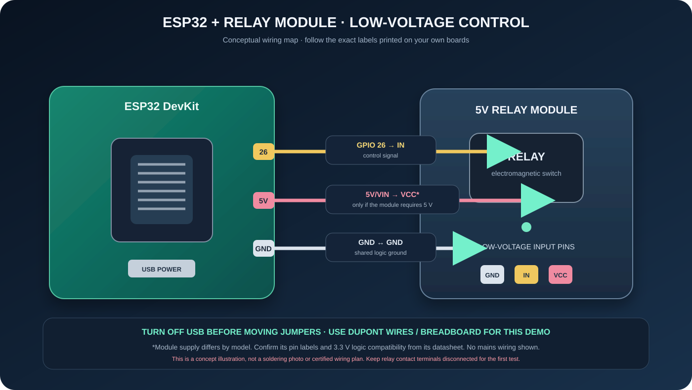

<div align="center">
  
  <h1>⚡ کلید بی‌سیم هوشمند | ESP32 × Cloudflare</h1>
  <p>آموزش قدم‌به‌قدم از صفر: از شناخت سیم‌ها تا پنل فارسی، Worker و KV</p>
  <p><b>Arduino ESP32</b> · <b>Cloudflare Workers</b> · <b>Workers KV</b> · <b>Cloudflare Pages</b></p>
</div>

> [!CAUTION]
> این مخزن یک نمونهٔ آموزشی است، نه وسیلهٔ آمادهٔ اتصال به برق شهر. دیاگرام و کد این پروژه به‌تنهایی ایمنی الکتریکی را تضمین نمی‌کنند. فعلاً فقط با بار کم‌ولتاژ و منبع تغذیهٔ ایمن آزمایش کن. طراحی، سیم‌کشی برق شهر، فیوز، فاصله‌های عایقی، محفظه و انتخاب رله باید توسط متخصص برق و مطابق مقررات محل انجام شود. هرگز برق شهر را به ESP32 وصل نکن.

## خیلی ساده: این پروژه چه می‌کند؟

پنل وب فارسی فرمان را به **Cloudflare Worker** می‌فرستد. Worker کاربر را احراز هویت می‌کند، اطلاعات دستگاه را از **KV** می‌خواند و از طریق شبکهٔ خصوصی به ESP32 فرمان می‌دهد. ESP32 خروجی GPIO را تغییر می‌دهد و وضعیت را برمی‌گرداند. پنل برای وضعیت روشن انیمیشن نوری دارد و وضعیت را هر ۵ ثانیه تازه می‌کند.

| بخش | پوشه | فناوری |
|---|---|---|
| فریمور دستگاه | `esp32/` | Arduino framework برای ESP32 |
| پنل فارسی | `web/` | HTML، CSS و JavaScript ساده |
| API و واسط دستگاه | `worker/` | Cloudflare Workers |
| تنظیمات دستگاه و آخرین وضعیت | `worker/` با KV | Workers KV |
| تصاویر راهنما | `docs/` | SVG، نمایش مستقیم در GitHub |

## نقشهٔ راه پروژه

1. بخش اول راهنما را برای تهیهٔ قطعات و آماده‌سازی ESP32 بخوان.
2. بخش دوم را برای ساخت KV، استقرار Worker و انتشار پنل در Pages انجام بده.
3. تا پیش از بررسی متخصص، خروجی رله را فقط به یک مدار آزمایشی کم‌ولتاژ وصل کن.

---

# بخش اول — سخت‌افزار و راه‌اندازی ESP32

## اول اسم قطعه‌ها را یاد بگیریم

- **ESP32**: برد کوچکی با Wi‑Fi. برنامه را روی آن می‌ریزیم؛ خودش قرار نیست برق وسیلهٔ بزرگ را از پایهٔ GPIO عبور بدهد.
- **ماژول رله (Relay Module)**: کلید برقی کوچکی که با یک فرمان کم‌ولتاژ، کنتاکت‌های جداگانه‌اش را وصل یا قطع می‌کند. ماژول‌های زیادی با تغذیهٔ 5V فروخته می‌شوند، ولی همه مثل هم نیستند.
- **GPIO 26**: یک پایهٔ خروجی نمونه روی ESP32. می‌گوید «روشن» یا «خاموش»؛ پایهٔ تغذیه نیست.
- **GND**: زمین یا مرجع مشترک مدار کم‌ولتاژ. اگر نقشهٔ ماژول می‌گوید زمین‌ها مشترک باشند، GND برد و GND ماژول باید با هم وصل شوند.
- **VCC**: پایهٔ تغذیهٔ ماژول. فقط ولتاژی را بده که روی همان ماژول نوشته شده یا دیتاشیتش گفته است.
- **IN**: ورودی فرمان رله. سیم سیگنال GPIO به IN می‌رود.
- **سیم جامپر Dupont**: سیم آماده با سرسوکت؛ برای نمونهٔ بردبوردی معمولاً به لحیم‌کاری نیاز نیست.

> **فرق تغذیه و فرمان:** 5V برق مورد نیاز بخش رله را می‌دهد؛ GPIO فقط فرمان کنترلی را می‌فرستد. GPIO 26 را به VCC وصل نکن. همهٔ بردهای رلهٔ موسوم به «5V» ورودی 3.3V ESP32 را درست تشخیص نمی‌دهند؛ سازگاری منطق 3.3V باید در مشخصات همان ماژول تأیید شود.

## تصویر اتصال مفهومی

### ظاهر کلی قطعه‌ها روی میز



این تصویر، عکس مرجعِ شماتیک‌نما برای شناخت کلی قطعات است؛ تصویر برد یا ماژول دقیق شما نیست و ترتیب پایه‌ها را از روی آن حدس نزن. سیم‌های سه‌رنگ فقط ارتباط کلی سیگنال، زمین و تغذیه را نشان می‌دهند. برای سیم‌کشی، تصویر شماتیک و نوشتهٔ واقعی روی قطعه را ببین.



تصویر بالا فقط رابطهٔ سیگنال‌های سمت کم‌ولتاژ را نشان می‌دهد. محل ترمینال‌ها، تغذیهٔ کویل و قطبیت ورودی در ماژول‌های مختلف فرق می‌کند؛ برچسب واقعی قطعه و دیتاشیت همان مدل ملاک است.

### هر خط تصویر یعنی چه؟

| از روی برد ESP32 | به پایهٔ ماژول رله | کار این سیم |
|---|---|---|
| پایهٔ GPIO که در کد انتخاب کرده‌ایم؛ اینجا GPIO 26 | `IN` | فرمان روشن/خاموش؛ این مثال فقط وقتی مناسب است که ورودی ماژول با منطق 3.3V کار کند |
| `5V` یا `VIN` روی برد | `VCC` | فقط اگر ماژول واقعاً به 5V نیاز داشته باشد و منبع/برد بتواند جریان لازم را بدهد |
| `GND` | `GND` | مرجع مشترک سیگنال در مدار کم‌ولتاژ؛ دستور سازندهٔ ماژول را بررسی کن |

**قبل از وصل کردن سیم، USB را جدا کن.** روی بعضی ESP32ها پایهٔ تغذیه با `5V`، `VIN` یا `VUSB` نام‌گذاری شده و چیدمان پایه‌ها بین مدل‌ها فرق دارد. روی بعضی رله‌ها سه پایهٔ `VCC`, `GND`, `IN` کنار هم هستند؛ روی بعضی دیگر ترتیب و جامپر فرق دارد. تصویر، ترتیب فیزیکی پایه‌ها را تضمین نمی‌کند. نوشتهٔ کنار پایه‌ها و دیتاشیت مدل خودت را بخوان.

### قدم‌های اتصال کم‌ولتاژ، مثل ساختن با لگو

1. ESP32 را از USB جدا کن و ماژول رله را هم از هر منبعی جدا نگه دار.
2. ماژول رله را پیدا کن و نوشته‌های کنار header سه‌پایه را بخوان. اگر نوشته‌ها پاک شده یا نقشهٔ سازنده را پیدا نمی‌کنی، حدس نزن و وصل نکن.
3. یک سیم جامپر از `GND` روی ESP32 به `GND` ماژول بزن.
4. یک سیم جامپر از GPIO استفاده‌شده در کد (پیش‌فرض `26`) به `IN` ماژول وصل کن.
5. فقط پس از تأیید دیتاشیت، تغذیه را وصل کن: برای ماژولی که صریحاً 5V می‌خواهد، معمولاً `5V/VIN` به `VCC` می‌رود. اگر ماژول به 3.3V نیاز دارد، `3V3` را فقط با تأیید مشخصات انتخاب کن.
6. یک بار سیم‌ها را از مبدأ تا مقصد دنبال کن و برچسب را دوباره بخوان. در این مرحله هیچ باری را به ترمینال‌های کنتاکت رله وصل نکن.
7. حالا ESP32 را با USB روشن کن. هنگام جابه‌جایی سیم‌ها دوباره USB را جدا کن.

### آیا باید سیم را لحیم کنم؟

برای آزمایش روی میز، معمولاً **نه**: ESP32 را روی بردبورد می‌گذاری و از سیم جامپر مناسب استفاده می‌کنی؛ خیلی از ماژول‌ها هم header پین دارند و به سیم Dupont وصل می‌شوند. اگر قطعه فقط سوراخ‌های خالی دارد و قرار است پین‌هدر نصب شود، لحیم‌کاری باید روی میز کار تمیز، با تهویه، عینک محافظ و هویهٔ مناسب انجام شود. هویه و قلع داغ‌اند؛ پیش از لمس یا جابه‌جایی بگذار خنک شوند. این مخزن عکس لحیم‌کاریِ مدل خاص ندارد، چون جای پایه‌ها در ماژول‌های مختلف یکی نیست. تصویر شماتیک بالاست و نباید با عکس واقعی یا دستور لحیم‌کاری برای برد ناشناخته اشتباه شود.

## فهرست خرید پیشنهادی

| قطعه | تعداد | توضیح انتخاب |
|---|---:|---|
| برد ESP32 DevKit | ۱ | مدل دارای USB و مبدل سریال؛ نوع دقیق USB-C یا Micro-USB مهم نیست |
| ماژول رلهٔ ایزوله | ۱ | ورودی سازگار با 3.3V، اپتوکوپلر و مشخصات مستند؛ ظرفیت بار را با کاربرد تطبیق بده |
| کابل USB داده | ۱ | برای آپلود فریمور و تغذیهٔ آزمایشی برد |
| بردبورد و سیم جامپر | چند عدد | فقط برای ساخت مدار کم‌ولتاژ روی میز |
| منبع 5V پایدار | ۱ | اگر مصرف ماژول از توان خروجی برد بیشتر است، منبع مناسب با جریان کافی؛ زمین مشترک فقط طبق طراحی ماژول |
| جعبه و محافظ | متناسب | برای نمونهٔ کم‌ولتاژ هم از تماس اتفاقی با سیم‌ها جلوگیری کن |

برای پروژهٔ واقعی برق شهر، لیست خرید بالا کامل نیست؛ قطعات حفاظت، فیوز، ترمینال، مسیرهای عایقی، محفظه و الزامات استاندارد باید توسط متخصص تعیین شوند. از رلهٔ بی‌نام با عبارت تبلیغاتی «10A» به‌تنهایی نتیجه‌گیری نکن: بار موتوری، جریان هجومی، دما و عمر کنتاکت مهم‌اند.

## ابزار نرم‌افزاری

- Arduino IDE را از منبع رسمی نصب کن.
- از Boards Manager، بستهٔ **esp32 by Espressif Systems** را نصب کن.
- برد ESP32 را با کابل داده وصل کن و مدل/درگاه درست را در منوی Board و Port انتخاب کن.
- فایل `esp32/SmartOutlet.ino` را باز کن.

## تنظیم و آپلود

در ابتدای فایل، نام و رمز شبکهٔ Wi‑Fi و یک توکن دستگاه تصادفی و طولانی را جایگزین کن:

```cpp
const char* WIFI_SSID = "نام-شبکه";
const char* WIFI_PASSWORD = "رمز-شبکه";
const char* DEVICE_TOKEN = "یک-رشته-تصادفی-طولانی-حداقل-۲۴-کاراکتر";
```

توکن دستگاه را در مخزن عمومی یا اسکرین‌شات منتشر نکن. مقدار GPIO پیش‌فرض 26 است؛ فقط وقتی از آن استفاده کن که برد و مدار واقعی‌ات آن را آزاد و مناسب نشان دهند. `RELAY_ACTIVE_LOW` نیز باید با مدل رله تطبیق داده شود. وضعیت ذخیره‌شده در حافظهٔ ESP32 با راه‌اندازی دوباره بازیابی می‌شود؛ بنابراین در نمونهٔ آزمایشی هم رفتار رله پس از قطع برق را بررسی کن.

در Arduino IDE روی Verify بزن و سپس Upload. Serial Monitor را روی 115200 باز کن و IP محلی چاپ‌شده را یادداشت کن. برای بررسی پایه، در مرورگر همان شبکه این مسیر را باز کن:

```text
http://IP-ESP32/health
```

پاسخ سالم `{"ok":true}` است. این health check فقط ارتباط محلی را تأیید می‌کند؛ به‌تنهایی وضعیت رله را نشان نمی‌دهد.

## بررسی اولیهٔ کم‌خطر

1. ابتدا ESP32 را فقط با USB روشن کن و لاگ سریال را بررسی کن.
2. در صورت نیاز به رله، تنها ورودی کم‌ولتاژ آن را طبق دیتاشیت وصل کن؛ سمت کنتاکت را بی‌بار بگذار.
3. وضعیت روشن و خاموش را چند بار بررسی کن و قطبیت فعال رله را پیدا کن.
4. دستگاه را از برق USB جدا و وصل کن تا رفتار راه‌اندازی مجدد را ببینی.
5. تا زمانی که متخصص مدار را بررسی نکرده، هیچ سیم برق شهر یا وسیلهٔ خانگی را متصل نکن.

اگر LED ماژول روشن نشد، USB را جدا کن و برچسب VCC/GND را دوباره بررسی کن. اگر LED روشن شد ولی رله کلیک نکرد، GPIO انتخابی، سازگاری 3.3V و active-low بودن ورودی را در دیتاشیت بررسی کن. سیم را در حالت روشن جابه‌جا نکن. کلیک شنیدن به معنی ایمن بودن یا مناسب بودن رله برای هیچ بار خاصی نیست.

---

# بخش دوم — Cloudflare: Worker، KV و Pages

## معماری و پیش‌نیاز

این نسخه سه جزء Cloudflare دارد:

1. **Worker (`smart-outlet-api`)**: API عمومی کنترل پنل و پل ارتباطی با ESP32.
2. **KV (`OUTLET_KV`)**: نگهداری نشانی و توکن هر دستگاه و cache وضعیت آخر.
3. **Pages**: فایل‌های استاتیک پنل وب.

### اصطلاح‌ها را ساده کنیم

- **Pages** ویترین است: فایل‌های HTML، CSS و JavaScript را به مرورگر نشان می‌دهد.
- **Worker** نگهبان و پیک است: درخواست مرورگر را بررسی می‌کند و پیام را به دستگاه می‌رساند.
- **KV** دفترچهٔ آدرس سبک است: برای `living-room` نشانی دستگاه و آخرین وضعیت را ذخیره می‌کند.

پیش‌نیاز: حساب Cloudflare، Node.js نسخهٔ LTS و npm؛ Git برای deployment خودکار اختیاری است. ESP32 معمولاً پشت مودم خانه و با IP خصوصی مثل `192.168.1.50` است. Worker روی Cloudflare نمی‌تواند مستقیم چنین IPای را ببیند. برای کنترل از راه دور باید Cloudflare Tunnel و Access را درست پیکربندی کنی یا راهکار خصوصی دیگری داشته باشی. **پورت HTTP دستگاه را روی مودم به اینترنت فوروارد نکن.**

> [!IMPORTANT]
> Worker این مخزن نمونهٔ API و KV است؛ راه‌اندازی Tunnel/Access به حساب و دامنهٔ واقعی وابسته است و خودکار پیکربندی نشده. تا وقتی مسیر امن را نساخته‌ای، Worker ابری نمی‌تواند به ESP32 محلی وصل شود. کد هنوز روی دامنه یا تونل واقعی آزمایش نشده.

## مرحلهٔ ۱ — آماده کردن کامپیوتر

Node.js نسخهٔ LTS را از [سایت رسمی Node.js](https://nodejs.org/) نصب کن. در ویندوز Start را باز کن، `PowerShell` را پیدا و اجرا کن، سپس بنویس:

```bash
node --version
npm --version
```

اگر هر دو شمارهٔ نسخه نشان دادند، آماده‌ای. اگر خطا دیدی، PowerShell را ببند و باز کن؛ اگر ادامه داشت Node.js را دوباره از منبع رسمی نصب کن.

## مرحلهٔ ۲ — نصب Wrangler و ورود

در File Explorer پوشهٔ `worker/` این پروژه را باز کن. در نوار آدرس بنویس `powershell` و Enter بزن تا ترمینال همان‌جا باز شود. سپس:

```bash
npm install --global wrangler
wrangler login
wrangler whoami
```

`wrangler login` مرورگر را باز می‌کند. حساب Cloudflare خودت را انتخاب کن و اجازهٔ اتصال Wrangler به آن حساب را بده. ترمینال پیام موفقیت می‌دهد؛ `wrangler whoami` باید حسابت را نشان دهد. اگر نصب سراسری نمی‌خواهی، پیش از هر فرمان `npx` بگذار؛ مثلاً `npx wrangler login`.

## مرحلهٔ ۳ — ساخت namespace در KV

در پوشهٔ `worker/` اجرا کن:

```bash
wrangler kv namespace create OUTLET_KV
```

خروجی شامل `id` است. مقدار آن را در `worker/wrangler.jsonc` جای `REPLACE_WITH_KV_NAMESPACE_ID` قرار بده. ID، secret نیست و فقط شناسهٔ اتصال به namespace است؛ توکن‌ها و رمزها را در فایل config ننویس.

برای توسعهٔ محلی می‌توانی namespace جداگانه بسازی و `preview_id` را نیز تنظیم کنی. تا وقتی محیط محلی را عمداً به KV واقعی وصل نکرده‌ای، دادهٔ آزمایشی را از دادهٔ واقعی جدا نگه دار.

### ساخت KV با داشبورد، بدون ترمینال

در Cloudflare داشبورد برو به **Workers & Pages → Storage & databases → KV → Create namespace**. نامی مثل `smart-outlet-devices` بگذار. بعد در Worker برو به **Settings → Bindings → Add → KV Namespace**؛ binding را دقیقاً `OUTLET_KV` نام بده، namespace ساخته‌شده را انتخاب و Deploy کن. اگر از روش Wrangler استفاده می‌کنی، ID خروجی ساخت namespace را در `worker/wrangler.jsonc` بگذار و Deploy کن. دو مسیر را با تنظیمات متناقض هم‌زمان پیش نبر.

## مرحلهٔ ۴ — ساخت secret احراز هویت پنل

یک توکن تصادفی طولانی برای ورود پنل بساز و از CLI ثبت کن:

```bash
wrangler secret put CONTROL_TOKEN
```

CLI مقدار را به‌صورت تعاملی می‌گیرد و در Cloudflare نگه می‌دارد؛ آن را در Git، `wrangler.jsonc` یا کد مرورگر قرار نده. برای این نمونه یک توکن مشترک ساده است؛ اگر چند کاربر یا استفادهٔ عمومی مدنظر است، پیش از انتشار واقعی به Cloudflare Access یا سامانهٔ هویت مناسب مهاجرت کن.

## مرحلهٔ ۵ — تنظیم دسترسی شبکهٔ دستگاه

Worker باید بتواند از طریق یک مسیر امن به endpoint دستگاه برسد. مقدار `url` نمونه در KV در ادامه باید به مبدأیی اشاره کند که Worker واقعاً به آن دسترسی دارد. IP خصوصی مانند `192.168.x.x` از Cloudflare Worker قابل‌دسترسی نیست، مگر خودت تونل/شبکهٔ خصوصی مناسب ساخته باشی. در مرحلهٔ تست محلی می‌توانی Worker را با `wrangler dev` اجرا کنی و از همان شبکه به ESP32 وصل شوی؛ برای production تونل و کنترل دسترسی را جداگانه تنظیم کن.

## مرحلهٔ ۶ — ثبت دستگاه در KV

در مقدار زیر `DEVICE_URL` را با مبدأ قابل‌دسترسی و `DEVICE_TOKEN` را با همان توکنی جایگزین کن که در فریمور ESP32 تنظیم کردی. این مقدار را در ترمینال مشترک/اسکرین‌شات یا commit عمومی نگذار.

PowerShell:

```powershell
$device = '{"url":"https://نشانی-خصوصی-دستگاه","token":"توکن-دستگاه"}'
wrangler kv key put --binding OUTLET_KV --namespace-id YOUR_KV_NAMESPACE_ID "device:living-room" $device
Remove-Variable device
```

در نسخه‌های Wrangler که شکل فرمان key متفاوت است، `wrangler kv key put --help` را ببین. در داشبورد هم می‌توانی Workers & Pages → KV → namespace → Add entry را باز کنی و key برابر `device:living-room` و value برابر JSON بالا بگذاری. KV مقدارها را به‌صورت متن ذخیره می‌کند.

### ثبت رکورد از داشبورد KV

Workers & Pages → KV → namespace → **Add entry**. در Key بنویس `device:living-room` و در Value یک JSON تک‌خطی قرار بده:

```json
{"url":"https://نشانی-تونل-خصوصی-خودت","token":"توکن-دستگاه-خودت"}
```

پیش از Save مقدارها را عوض کن. `token` محرمانه است؛ آن را در README عمومی، اسکرین‌شات یا commit قرار نده.

## مرحلهٔ ۷ — استقرار Worker

از پوشهٔ `worker/`:

```bash
wrangler deploy
```

پس از موفقیت، نشانی `https://smart-outlet-api.<subdomain>.workers.dev` را یادداشت کن. مسیرهای این نمونه:

```text
GET  /api/devices/living-room/state
POST /api/devices/living-room/state   body: {"on":true}
```

هر درخواست پنل باید هدر `Authorization: Bearer <CONTROL_TOKEN>` داشته باشد. پاسخ GET وضعیت خوانده‌شده از دستگاه است؛ اگر دستگاه در دسترس نباشد، آخرین cache KV با `stale: true` برمی‌گردد. KV برای وضعیت با تأخیر کم و cache مناسب است، اما جایگزین دیتابیس تراکنشی/زمان‌واقعی نیست.

پس از Deploy، در Workers & Pages باید `smart-outlet-api` را ببینی. تنظیماتش را باز کن و بررسی کن `OUTLET_KV` در Bindings و `CONTROL_TOKEN` در Variables and Secrets باشد.

## مرحلهٔ ۸ — انتشار پنل با Cloudflare Pages

در داشبورد Cloudflare:

1. Workers & Pages را باز کن.
2. **Create application → Pages → Direct Upload** را انتخاب کن.
3. پروژه را `smart-outlet-ui` نام‌گذاری کن.
4. پوشهٔ `web/` را انتخاب کن؛ باید `index.html`, `styles.css`, `app.js` داخلش باشند. کل فولدر پروژه را انتخاب نکن.
5. **Deploy site** را بزن و منتظر بمان نشانی `*.pages.dev` ظاهر شود.
6. نشانی را باز کن؛ باید کارت کنترل و فرم اتصال را ببینی.

یا با Wrangler CLI:

```bash
# Run these commands from the repository root (the folder containing web/ and worker/).
wrangler pages project create smart-outlet-ui
wrangler pages deploy ./web --project-name=smart-outlet-ui
```

Direct Upload برای این راهنمای دستی مناسب است؛ اگر deployment خودکار با هر push گیت‌هاب می‌خواهی، هنگام ساخت پروژه Pages گزینهٔ Git integration را انتخاب کن. طبق مستندات Cloudflare، پروژهٔ Direct Upload بعداً به Git integration تبدیل نمی‌شود و برای این تغییر باید پروژهٔ جدا ساخت.

## مرحلهٔ ۹ — اتصال پنل

در پنل، آدرس Worker را وارد کن؛ مثلاً:

```text
https://smart-outlet-api.<subdomain>.workers.dev
```

توکن `CONTROL_TOKEN` را در فیلد کلید کنترلی بگذار و «ذخیره و اتصال» را بزن. توکن در `sessionStorage` همان مرورگر می‌ماند و نباید دستگاه یا مرورگر مشترک را برای این کار استفاده کرد. برای production بهتر است احراز هویت قوی‌تری از یک توکن ثابت پیاده کنی.

## عیب‌یابی

| نشانه | بررسی |
|---|---|
| `401 Unauthorized` | secret به نام `CONTROL_TOKEN` تنظیم شده و مقدار پنل دقیقاً همان است؟ |
| `Device is not registered in KV` | کلید `device:living-room` در KV و binding `OUTLET_KV` درست است؟ |
| `502 Device unreachable` | Worker به نشانی تونل دسترسی دارد؟ ESP32 روشن و متصل است؟ توکن دستگاه یکی است؟ |
| CORS یا Failed to fetch | در DevTools → Network پاسخ OPTIONS را ببین؛ درخواست مستقیم به IP محلی از صفحهٔ HTTPS ممکن است با mixed content مسدود شود. |
| پاسخ KV قدیمی | `stale: true` یعنی دستگاه در دسترس نبوده و Worker آخرین مقدار cache شده را برگردانده است. |
| رله وارونه عمل می‌کند | مدل ماژول active-low/active-high و مقدار `RELAY_ACTIVE_LOW` را با مدار واقعی تطبیق بده. |

## فایل‌ها

```text
esp32/SmartOutlet.ino   firmware
web/                    Persian dashboard
worker/src/index.js     Worker API
worker/wrangler.jsonc   Worker + KV binding
docs/                   GitHub-ready diagrams
```

## امنیت و محدودیت‌ها

- توکن ESP32 و `CONTROL_TOKEN` را commit نکن؛ در نسخهٔ واقعی برای secrets از Cloudflare Secrets/Access استفاده کن.
- Worker با CORS باز و توکن مشترک نمونهٔ آموزشی است؛ CORS جایگزین احراز هویت نیست.
- endpoint دستگاه در این نمونه HTTP ساده است و فقط باید پشت شبکه/تونل کنترل‌شده قرار بگیرد. توکن را روی اینترنت عمومی بدون TLS و محدودیت دسترسی ارسال نکن.
- تا زمانی که روی برد و رلهٔ دقیق کامپایل، آزمایش و بررسی ایمنی انجام نشده، این پروژه را وسیلهٔ برق شهر تلقی نکن.
- کد در این مخزن نمونه است و هیچ گواهی ایمنی یا تضمین مناسب‌بودن برای بار خاصی ارائه نمی‌دهد.

## مجوز

برای انتشار عمومی، پیش از آپلود یک مجوز متن‌باز (مثلاً MIT) انتخاب و فایل `LICENSE` اضافه کن. در نبود مجوز، کپی و استفادهٔ مجدد از نظر حقوقی خودکار آزاد محسوب نمی‌شود.

## منابع رسمی Cloudflare

- [Cloudflare Workers KV: شروع به کار](https://developers.cloudflare.com/kv/get-started/)
- [Workers KV bindings](https://developers.cloudflare.com/kv/concepts/kv-bindings/)
- [تنظیمات Wrangler](https://developers.cloudflare.com/workers/wrangler/configuration/)
- [Secrets برای Workers](https://developers.cloudflare.com/workers/configuration/secrets/)
- [Cloudflare Pages Direct Upload](https://developers.cloudflare.com/pages/get-started/direct-upload/)
